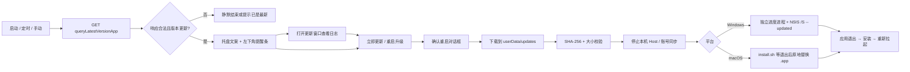
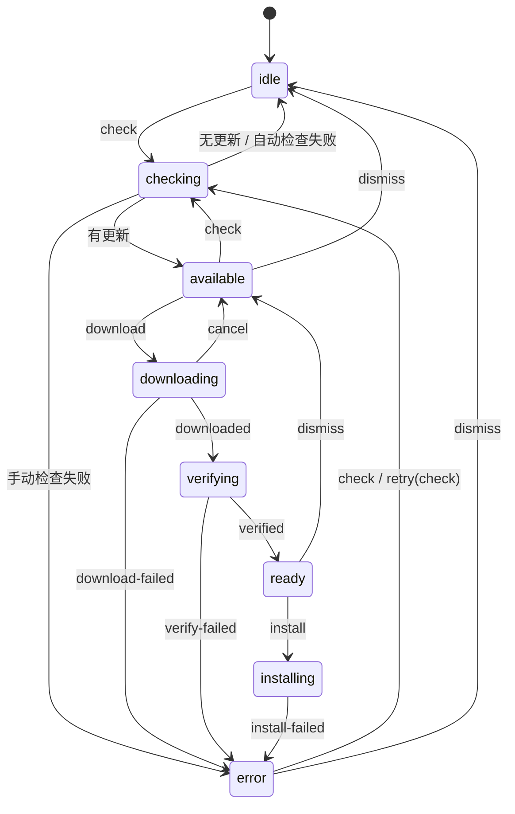

# Desktop 在线升级逻辑说明

本文说明 WorkDSH Desktop（警务助手）当前的在线升级实现：从检查后台版本、判断是否需要更新、提示用户，到下载校验、退出重启并完成安装的完整链路，以及各阶段的失败处理和已知边界。

实现全部位于 Electron 主进程，渲染层只负责展示状态。入口是 [`workdsh-main.ts`](../apps/desktop/src/workdsh-main.ts) 的 `startUpdater()`。

## 1. 一句话概括

客户端定期向后台 `queryLatestVersionApp` 查询当前平台/架构的最新发布记录；只有版本号**严格大于**本机版本时才提示；用户确认后完整下载安装包，边下边算 SHA-256，校验通过后停止本机 DSH 运行，把安装交给独立进程或助手脚本，应用退出并由安装器重新拉起。



## 2. 启用范围与总开关

更新服务只有在以下条件同时满足时才会创建：

| 条件 | 说明 |
| --- | --- |
| 平台为 Windows x64 | `process.platform === 'win32' && process.arch === 'x64'`，走 NSIS 静默升级 |
| 或平台为 macOS 且已打包 | `process.platform === 'darwin' && app.isPackaged`；macOS 开发态不触碰自身应用 |
| `server.updateEnabled !== false` | 关闭后完全不检查、不提示，托盘也不会出现更新项 |

不满足时 `updater` 为 `undefined`：Linux、Windows arm64、macOS 开发态都不会有在线升级，托盘菜单只有“显示主界面”和“退出软件”。

客户端没有“关闭自动更新”的用户设置。唯一的用户侧抑制手段是“跳过某个版本”（见第 7.4 节）。

## 3. 配置与接口地址

更新相关配置来自应用配置的 `server` 段：

| 配置项 | 默认值 | 作用 |
| --- | --- | --- |
| `server.baseUrl` | `http://127.0.0.1:18080/ytsj-ai` | 后台根地址 |
| `server.latestVersionPath` | `/desktop-client/queryLatestVersionApp` | 版本查询接口路径 |
| `server.appId` | `police-assistant` | 发布记录的应用标识 |
| `server.updateCheckIntervalMinutes` | `5` | 自动检查间隔，允许 5–10080 的整数 |
| `server.updateEnabled` | `true` | 在线更新总开关 |

`baseUrl` 的优先级为：

1. 环境变量 `WORKDSH_SERVER_BASE`
2. `userData/workdsh-app.json`
3. 打包资源 `Resources/workdsh-app.json`
4. 代码内 `APP_CONFIG_DEFAULTS`

接口地址由 `baseUrl` 去掉末尾 `/` 后拼接接口路径得到，查询参数固定为 `appId`、`platform`、`arch`。

## 4. 检查时机与触发源

| 触发源 | 行为 |
| --- | --- |
| 启动首检 | 应用就绪后立即执行一次自动检查（不再延后），确保强制更新在登录 / 进入工作区前就拦下 |
| 周期检查 | 每 `max(5, updateCheckIntervalMinutes)` 分钟一次，带 ±10% 抖动；下一次在本次结束后重新计时 |
| 系统唤醒 | 监听 `powerMonitor.resume`，距上次检查 ≥5 分钟才补检一次 |
| 托盘“检查更新…” | 无更新时执行手动检查；有更新时该菜单项变为“新版本 x（点击更新）”，点击只显示左下角提醒条，不再弹窗 |
| 更新窗口“重试” | 检查失败时按手动检查重试 |
| 安装失败后的重试 | 只回到“就绪”，不会自动重新安装 |

两条重要约束：

- 只有 `idle`、`available`、`error` 三种状态允许发起新检查。下载、校验、安装、检查进行中再次触发检查会被状态机直接忽略。
- 自动检查失败保持静默（回到 `idle`，不弹窗）。手动检查失败才进入 `error` 并显示更新窗口。

手动检查完成后，仅有“已是最新”或“检查失败”才会主动弹出更新窗口；发现新版本时只显示左下角提醒条，窗口由用户从提醒条打开。

## 5. 请求与响应校验

### 5.1 请求

```http
GET {baseUrl}/desktop-client/queryLatestVersionApp?appId=police-assistant&platform=win32&arch=x64
```

- 单次超时 15 秒。
- 请求头带 `Accept: application/json`、`Cache-Control: no-cache`、`Pragma: no-cache`。
- `credentials: 'omit'`：检查接口匿名，不携带登录态。
- `redirect: 'follow'`。
- 主进程使用 Electron `net.fetch`，复用系统代理、系统证书库和内网自建 CA。
- 响应体上限 512 KiB；空响应、超长响应、非 JSON 都视为非法响应。

### 5.2 后台信封

后台为 Jeecg 风格信封：

```json
{
  "code": 200,
  "success": true,
  "result": { }
}
```

判定规则：

| 响应 | 结果 |
| --- | --- |
| HTTP 非 2xx | 失败：`server-error` |
| 空响应 / 超过 512 KiB / 非 JSON / 非对象 | 失败：`invalid-response` |
| `code !== 200` 或 `success === false` | 失败：`server-error` |
| `result` 为 `null` 或缺失 | 成功，但没有发布记录，按“已是最新”处理 |
| `result` 为对象 | 继续做版本记录字段校验 |

### 5.3 版本记录字段

客户端只读取以下字段，其余字段（部门、创建人等）不进入客户端：

| 字段 | 校验规则 | 不合法时 |
| --- | --- | --- |
| `appId` | 缺失时回落为客户端配置的 `appId`；必须与配置一致 | `app-mismatch` |
| `platform` | 必须与 `process.platform` 逐字相等（如 `win32`、`darwin`） | `platform-mismatch` |
| `arch` | 必须与 `process.arch` 逐字相等（如 `x64`、`arm64`） | `arch-mismatch` |
| `version` | 严格 SemVer 2.0.0，长度 ≤128 | `invalid-version` |
| `filePath` | `http`/`https` 绝对地址，或 `/` 开头的相对路径（按 `baseUrl` 补全）；不允许用户名密码；长度 ≤2048 | `invalid-url` |
| `fileSize` | 1 字节–2 GiB 的整数，也接受纯数字字符串 | `invalid-size` |
| `sha256` | 64 位十六进制，统一转小写 | `invalid-hash` |
| `notes` | Markdown 文本，最长 32 KiB；超限直接判为非法 | `notes-too-long` |
| `publishedTime` | 最长 64 字符，仅用于展示 | 忽略该字段 |
| `releaseType` | 归一为小写；非法值回退 `stable`；只用于展示，不过滤更新 | 回退 `stable` |
| `mandatory` | 兼容 `true` / `1` / `"1"` / `"true"` | 视为 `false` |
| `minimumVersion` | 合法 SemVer 才生效；非法则忽略，不影响本次升级 | 忽略 |
| `sequence` | 可选整数，当前不参与判断 | 忽略 |

> 注意：`platform` / `arch` 是**严格字符串匹配**。后台把 Windows 写成 `"windows"` 会被判为非法响应，而不是“没有更新”。
>
> 除 `network`、`timeout`、`server-error` 外，所有字段级拒绝在界面统一显示为 `invalid-response`（“后台返回的数据无法识别，请联系管理员”）。

## 6. 版本比较与强制更新

### 6.1 版本比较

客户端自实现严格 SemVer 2.0.0 比较，不引入第三方 `semver` 依赖：

- 主版本、次版本、补丁版本逐段按数值比较。
- 有预发布标识的版本低于同版本正式版（`1.0.1-beta < 1.0.1`）。
- 预发布标识逐段比较：数字段按数值，数字段低于字母段，其余按 ASCII 字典序；前缀相同则段数少者更小。
- 构建元数据（`+build`）被忽略，不参与比较。
- 版本号非法（含前导零、超长等）时直接视为不可比较，不提示更新。

只有候选版本**严格大于** `app.getVersion()`（即 `apps/desktop/package.json` 的 `version`）时才生成更新候选。相等或更旧一律按“已是最新”处理。

### 6.2 强制更新判定

满足任一条件即为强制更新：

- 后台 `mandatory` 为真；
- 后台给出合法 `minimumVersion`，且本机版本低于它。

强制更新会改变以下行为：

- 自动检查时不会因“已跳过该版本”而隐藏；
- 发现新版本后直接自动打开更新窗口；
- 窗口带“强制更新”徽标，作为主窗口的模态子窗口；
- 不显示“稍后”按钮，关闭按钮被禁用，关闭事件被拦截；
- 左下角提醒条不显示（避免用户只看提醒条而不处理）；
- 禁止进入工作区：登录请求、环境准备完成后的启动都会被拦下（停在登录页 / 过场页），
  下载失败（`error`）时保留窗口与“重试”，不因一次网络故障把用户彻底锁死；
- 入口窗口被主界面窗口替换时，更新窗口的父窗口随之迁移，不会被连带销毁。

## 7. 三个提示通道

### 7.1 托盘菜单

托盘常驻，菜单中的更新项文案随状态变化：

| 状态 | 文案 | 点击行为 |
| --- | --- | --- |
| 无更新 / 检查失败 | `检查更新…` | 执行手动检查 |
| `available` / `ready` | `新版本 x（点击更新）` | 只确保左下角提醒条显示 |
| `downloading` | `正在下载更新…` | 点击无额外动作 |
| `installing` | `正在安装更新…` | 点击无额外动作 |

### 7.2 左下角提醒条

独立透明小窗口，挂在当前应用窗口（登录页或工作台）之下：

- 尺寸 396×64，距父窗口左下角 12 px，不占任务栏。
- 仅在**非强制**且状态为 `available` 或 `ready` 时显示。
- 父窗口移动、缩放、最小化、隐藏、恢复时跟随；登录页与工作台切换时按新父窗口重建。
- 三个操作：
  - **更新日志**：打开独立更新窗口；
  - **重启升级**：弹出“升级到 x 需要重启软件”确认框，确认后下载、安装并重启；
  - **×**：收起提醒条；若当前是“发现新版本”（`available`），同时记住跳过该版本。
- 文案：刚发现时为“发现新版本 x”，下载完成未安装时为“新版本已就绪”。

### 7.3 独立更新窗口

- 固定宽 560，高度随阶段变化：检查 300、已最新 320、发现更新 520、下载/校验/就绪/安装 340、失败 360。
- 无系统边框，自绘标题栏；可最大化、可最小化（强制更新模态时不可最小化）。
- 强制更新且主窗口存在时，作为主窗口的模态子窗口。
- 关闭事件被拦截：退出应用或安装阶段放行，其余情况阻止默认关闭；非强制时关闭等于隐藏。
- 内容由主进程下发的只读视图渲染，不包含下载地址、文件路径或原始异常；页面 CSP 为 `default-src 'none'`，更新说明的原始 HTML 会被转义。

各阶段界面：

| 阶段 | 界面 |
| --- | --- |
| `checking` | “正在检查更新…” |
| `idle` | “警务助手 x 已是最新版”，按钮“我知道啦” |
| `available` | “发现新版本 x”、体积/发布时间/版本类型、更新说明；“立即更新”+“稍后”（强制时无“稍后”） |
| `downloading` | “正在下载更新”，百分比进度、总量 |
| `verifying` | “正在校验安装包”，状态文案“正在校验完整性与文件签名…” |
| `ready` | “正在安装更新 / 正在准备安装…” |
| `installing` | “正在安装更新 / 正在安装…” |
| `error` | “更新失败”、失败原因、“重试”+“关闭” |

“立即更新”实际执行的也是“确认重启 → 下载 → 自动安装”，不会停在仅下载状态。

### 7.4 “稍后”“关闭”“跳过”的区别

| 操作 | 位置 | 实际行为 |
| --- | --- | --- |
| 稍后 | 更新窗口 | 只是隐藏窗口，不写跳过记录；左下角提醒条继续保留 |
| 关闭 | 更新窗口 | 非强制时隐藏窗口；强制更新或安装阶段不允许关闭 |
| × | 左下角提醒条 | 收起提醒条：“发现新版本”阶段会把该版本写入 `update-skipped.json`；“新版本已就绪”阶段只退回可下载状态 |
| 关闭 | 错误页 | 隐藏窗口，不写跳过记录 |
| 重试 | 错误页 | 按失败阶段重试（见第 10 节） |

跳过记录只保存**一个版本号**：

- 自动检查遇到相同版本时不再提示；
- 手动检查仍会显示该版本；
- 强制更新不受跳过影响；
- 后台发布更高版本时，版本号不再相等，会重新提示；
- 成功升级到新版本后，旧记录不再匹配任何候选，实际失效。

## 8. 下载与完整性校验

### 8.1 落盘位置

```
{userData}/updates/app/{version}/setup.exe     Windows
{userData}/updates/app/{version}/update.zip    macOS
```

下载先写 `{目标文件}.part`（权限 0600），校验通过后才改名为正式文件。

### 8.2 下载流程

1. 创建目标目录，删除残留 `.part`。
2. 检查目标卷空闲空间：小于“安装包大小 + 256 MiB”则直接失败（`disk-insufficient`）；读取磁盘信息失败时不阻断。
3. 发起 GET，`Accept-Encoding: identity`（禁止压缩，保证字节数与 `Content-Length` 一致），跟随重定向。
4. HTTP 非 2xx → `http-status`（界面映射为 `server-error`）。
5. 若响应带 `Content-Length` 且与后台声明大小不一致 → `size-mismatch`。
6. 流式读取并写盘，同时更新 SHA-256：
   - 写入短写或写盘异常 → `write-failed`；
   - 累计字节超过声明大小 → `size-mismatch`；
   - 连续 60 秒没有新数据 → 中止并判为 `timeout`；
   - 用户主动取消 → `cancelled`。
7. 每跨过一个整数百分比才上报一次进度；进度事件不经过任务队列，直接推进状态。
8. 流结束后 `sync()` 并关闭文件；实际字节数不等于声明大小 → `size-mismatch`；摘要不等于后台 `sha256` → `hash-mismatch`。
9. 删除旧的正式文件，把 `.part` 改名为正式文件。
10. 任一步失败都会删除 `.part`；取消时还会额外清理已下载文件。

### 8.3 “校验”阶段

下载器只有在大小与 SHA-256 都通过后才返回成功，因此状态机进入 `verifying` 后会立即推进到 `ready`，界面上的“正在校验安装包”只是短暂过渡，没有第二次独立的校验动作。

## 9. 安装交接

### 9.1 共性

用户确认安装后，主进程会先停止本机运行，但保留登录态与用户数据：

- 停止账号同步；
- 关闭账号授权/本地身份；
- 取消登录请求；
- 企业模式下同样关闭企业授权并取消登录请求；
- 停止本机 DSH Host 子进程。

被升级流程主动停止的 Host 进程会登记为“升级停止”，它的退出事件只按正常停止处理，不弹错误提示、也不回到入口页；只有非升级原因导致的意外退出才提示“本机运行已停止”。

随后按平台交接。交接失败时：`updaterInstalling` 复位，应用回到登录页，更新状态进入 `error`，失败码统一为 `installer-failed`，应用本身不退出。

### 9.2 Windows

1. 校验安装包：文件存在、≥64 字节、`MZ` 头、PE 签名偏移在文件范围内、`PE\0\0`。**不做数字签名校验**。
2. 准备安装进度页进程：
   - 打包态：用 `robocopy` 把安装目录复制到 `%TEMP%\workdsh-update-progress-app`，跳过 `resources\workdsh-runtime`（约 900 MB）；robocopy 退出码 <8 视为成功。
   - 开发态：直接使用当前 `process.execPath`，并把应用路径作为首个参数。
3. 以独立 `--user-data-dir=%TEMP%\workdsh-update-progress` 启动进度进程，避免与主程序共用 Chromium 单例锁。不能加 `windowsHide`，否则首个窗口无法显示。
4. 进度进程加载与更新窗口一致的“正在安装更新”页面，写入 ready 标记后显示；主进程最多等 8 秒，等到标记或超时后清理标记并退出。
5. 进度进程等待 1.5 秒确保主程序已退出，然后执行安装器：

   ```
   setup.exe /S --updated
   ```

6. `installer.nsh` 中 `--updated` 会跳过许可协议、安装模式和安装目录页；安装成功后由 `.onInstSuccess` 拉起新版本 exe。
7. 安装器退出后进度进程关闭页面并退出。
8. 主程序在交接完成后销毁所有窗口并退出。

下次启动时会清理上一次留下的进度页副本与临时 userData（启动时一次，60 秒后再一次，避免旧进程仍占用文件）。

### 9.3 macOS

仅在已打包的 macOS 上启用：

1. 下载的是 ZIP 更新包。
2. 解压到 `{userData}/updates/staging/{version}`（`ditto -x -k`）。
3. 校验更新包：
   - 必须且只能包含一个 `.app`；
   - 必须是目录且含 `Contents/Info.plist`；
   - 可执行文件必须是 Mach-O（四种魔数之一）；
   - 新旧应用的 `CFBundleIdentifier` 必须都存在且一致。
4. 检查当前 `.app` 所在目录是否可写，不可写则安装失败。
5. 在暂存目录写入 `install.sh`（权限 0700），以 detached 方式启动 `/bin/sh`：
   - 每秒轮询，等待当前进程 PID 退出；
   - 清理旧的 `.new`，用 `ditto` 把新 `.app` 复制到同卷的 `.new`；
   - 删除旧 `.app`，把 `.new` 改名为目标 `.app`（同卷改名，接近原子替换）；
   - 清除 `com.apple.quarantine` 扩展属性；
   - `open` 新应用；
   - 复制或改名失败时保留/重新打开旧版本，避免用户没有可用应用；
   - 最后删除暂存目录。
6. 脚本日志写入 `{userData}/logs/update-install.log`。
7. 主进程启动脚本后立即退出，由脚本完成替换和重新拉起。

macOS 不支持 DMG 更新包，也不支持未打包的开发态自更新。

## 10. 状态机与失败、重试矩阵

状态机是纯 reducer，副作用以 effect 列表返回，由服务层串行执行。状态定义：



关键迁移规则：

| 事件 | 前置状态 | 结果 |
| --- | --- | --- |
| `check` | 仅 `idle` / `available` / `error` | 进入 `checking`；其他状态忽略 |
| `checked` 无候选 | `checking` | `idle`，记录检查时间 |
| `checked` 有候选 | `checking` | `available` |
| `check-failed` 自动 | `checking` | `idle`（静默） |
| `check-failed` 手动 | `checking` | `error`，`manual = true` |
| `download` | `available` 且版本匹配 | `downloading`，进度 0 |
| `progress` | `downloading` | 更新百分比；相同整数百分比不触发状态变更 |
| `downloaded` | `downloading` | `verifying` |
| `verified` | `verifying` | `ready` |
| `install` | `ready` 且版本匹配 | `installing` |
| `cancel` | `downloading` | 回到 `available`，删除安装包与 `.part` |
| `dismiss` | `available` | `idle`，并记住跳过该版本 |
| `dismiss` | `ready` | 回到 `available`，**保留**已下载文件 |
| `dismiss` | `error` | `idle` |
| `retry` | `error` | 见下表 |

重试矩阵：

| 失败阶段 | 重试行为 |
| --- | --- |
| 检查 | 以手动检查重新发起，进入 `checking` |
| 下载 | 从 0 重新下载（无断点续传），进入 `downloading` |
| 校验 | 重新下载，进入 `downloading` |
| 安装 | 回到 `ready`，不自动重试安装 |

其他并发规则：

- 所有状态事件进入串行队列，避免检查、下载、安装互相穿插。
- 进度事件直接更新状态，不排队。
- 状态守卫失败时保持原状态且不产生副作用，视为正常并发，不报错。
- `retry` 时若候选已丢失，直接回到 `idle`。

失败码与界面文案：

| 失败码 | 界面文案 |
| --- | --- |
| `network` | 网络不可用，请检查内网连接后重试。 |
| `timeout` | 连接后台超时，请稍后重试。 |
| `server-error` | 后台服务暂时不可用，请稍后重试。 |
| `invalid-response` | 后台返回的数据无法识别，请联系管理员。 |
| `size-mismatch` | 安装包大小与后台记录不一致，请重试。 |
| `hash-mismatch` | 安装包校验失败，请重试。 |
| `disk-insufficient` | 磁盘空间不足，请清理后重试。 |
| `write-failed` | 无法写入安装包，请检查磁盘或安全软件。 |
| `host-stop-failed` | 无法停止本机任务，更新尚未安装。 |
| `installer-failed` | 安装程序启动失败，请稍后重试。 |
| `cancelled` | 下载已取消。 |
| 其他/未知 | 更新失败，请稍后重试。 |

> `host-stop-failed` 等部分枚举当前没有实际产生路径；安装交接中的任何异常都会被服务层统一映射为 `installer-failed`。

## 11. 落盘位置与日志

| 路径 | 内容 |
| --- | --- |
| `{userData}/updates/app/{version}/setup.exe` | Windows 安装包 |
| `{userData}/updates/app/{version}/update.zip` | macOS 更新包 |
| `{userData}/updates/app/{version}/*.part` | 下载临时文件（失败/取消后删除） |
| `{userData}/updates/staging/{version}` | macOS 解压与助手脚本暂存目录 |
| `{userData}/update-skipped.json` | 跳过的版本，`{ "version": "x.y.z" }`，权限 0600 |
| `{userData}/logs/update.log` | 更新日志（检查、下载、安装各阶段 journal） |
| `{userData}/logs/update-install.log` | macOS 原地替换脚本日志 |
| `%TEMP%\workdsh-update-progress-app` | Windows 安装进度页外壳副本 |
| `%TEMP%\workdsh-update-progress` | Windows 进度进程的独立 userData |
| `%TEMP%\workdsh-update-ready-{pid}.flag` | 进度页交接标记，8 秒内使用后删除 |

## 12. 已知边界与注意事项

- **全量更新**：每次下载完整安装包，没有增量/差分包。
- **无断点续传**：失败或取消后重试都从 0 开始；退出应用也会中断下载。
- **没有用户可见的“取消下载”按钮**：下载、校验、就绪阶段窗口只有进度展示，按钮被隐藏；`cancel` 仅由内部逻辑调用。
- **没有代码签名校验**：Windows 只校验 PE 结构，macOS 只校验 Mach-O 结构、bundle 结构和 `CFBundleIdentifier`。界面“正在校验完整性与文件签名”中的“文件签名”与实现不一致，实际是大小 + SHA-256 + 文件结构校验。
- **信任链依赖后台与传输**：安装包地址允许 `http`，摘要也来自同一个后台响应。若后台或链路被篡改，SHA-256 不能提供独立可信保障；生产部署应使用 HTTPS 并保护后台发布权限。
- **安装失败后的重试**：安装失败进入 `error`，点击“重试”只回到 `ready`，当前界面没有再次触发安装的按钮；强制更新下窗口又不可关闭。实际恢复方式是退出并重新启动应用（启动后会重新检查）。
- **macOS 权限**：应用放在用户不可写的目录（如部分受管 `/Applications`）时，更新会在可写性检查处失败。
- **macOS 更新包格式**：只接受包含且仅包含一个 `.app` 的 ZIP；不接受 DMG、PKG。
- **平台/架构严格匹配**：后台记录的 `platform`、`arch` 必须与 Node 的 `process.platform`、`process.arch` 完全一致。
- **通道不参与过滤**：`releaseType` 只影响展示文案（正式版/公测版/内测版），客户端不会因为它是 `beta` 或 `alpha` 而拒绝；只要版本号更大就会提示。
- **跳过只记一个版本**：只保存最后一个被 × 掉的版本；手动检查、强制更新都会绕过该记录。
- **强制更新是产品约束而非安全边界**：它通过模态窗口、隐藏“稍后”、禁用关闭来阻止忽略，但用户仍可退出应用；下次启动会再次提示。
- **更新说明渲染**：Markdown 由主进程渲染，原始 HTML 会被转义；超长说明（>32 KiB）会导致整条发布记录被拒绝。
- **安装期退出会跳过常规关闭确认**：交接成功后主进程直接销毁窗口并退出，安装器/助手负责重新拉起。
- **企业部署配置不直接改写更新地址**：更新请求使用 `server.baseUrl` 的解析结果（见第 3 节），`workdsh-config.json` 中的企业后台地址只用于企业连接入口。

## 13. 关键源码索引

| 文件 | 职责 |
| --- | --- |
| [`workdsh-main.ts`](../apps/desktop/src/workdsh-main.ts) | 更新服务装配、托盘/提醒条/窗口、检查调度、安装交接、IPC |
| [`update-service.ts`](../apps/desktop/src/update-service.ts) | 串联检查、下载、状态机与安装副作用 |
| [`update-state.ts`](../apps/desktop/src/update-state.ts) | 纯状态机与全部状态迁移守卫 |
| [`update-client.ts`](../apps/desktop/src/update-client.ts) | 版本查询接口的传输层（超时、信封解包） |
| [`update-release.ts`](../apps/desktop/src/update-release.ts) | 响应字段校验、候选生成与强制更新判定 |
| [`update-version.ts`](../apps/desktop/src/update-version.ts) | 严格 SemVer 解析与比较 |
| [`update-download.ts`](../apps/desktop/src/update-download.ts) | 流式下载、磁盘检查、进度、SHA-256、原子改名 |
| [`update-install.ts`](../apps/desktop/src/update-install.ts) | Windows 安装包 PE 结构校验 |
| [`update-install-mac.ts`](../apps/desktop/src/update-install-mac.ts) | macOS 解压、结构校验、原地替换脚本 |
| [`update-window.ts`](../apps/desktop/src/update-window.ts) | 更新窗口静态页面与 CSP |
| [`update-preload.ts`](../apps/desktop/src/update-preload.ts) | 更新窗口状态渲染、按钮与失败文案 |
| [`update-toast.ts`](../apps/desktop/src/update-toast.ts) | 左下角提醒条页面 |
| [`update-toast-preload.ts`](../apps/desktop/src/update-toast-preload.ts) | 提醒条状态渲染与三个动作 |
| [`app-config.ts`](../apps/desktop/src/app-config.ts) | 更新相关配置默认值与校验 |
| [`installer.nsh`](../apps/desktop/build/installer.nsh) | NSIS `--updated` 静默升级流程 |
